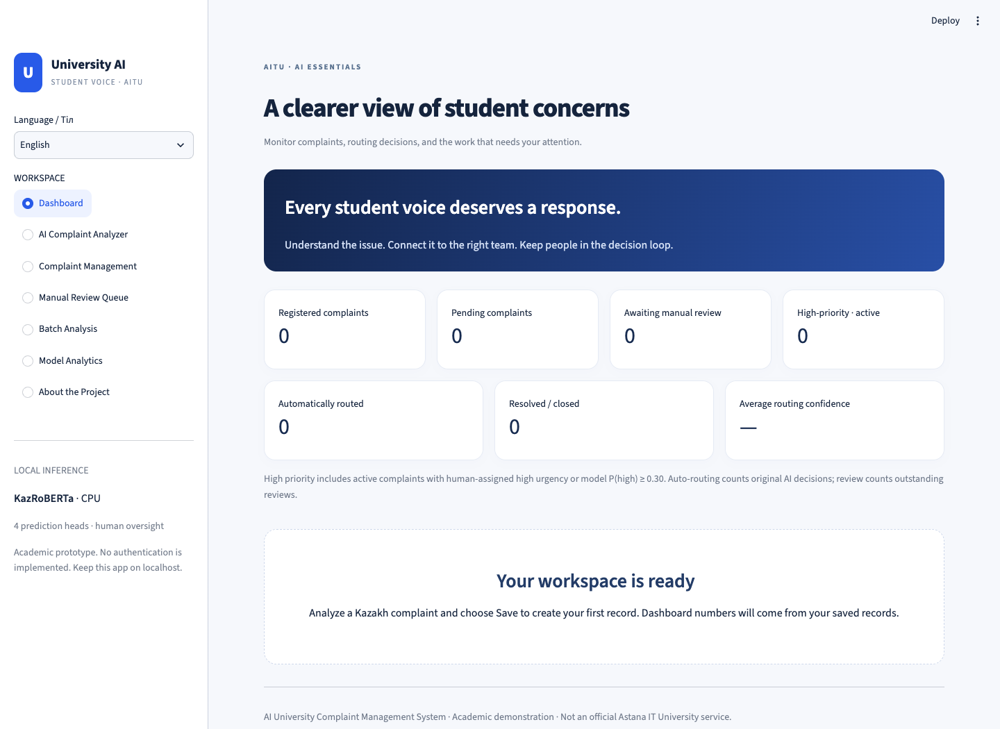
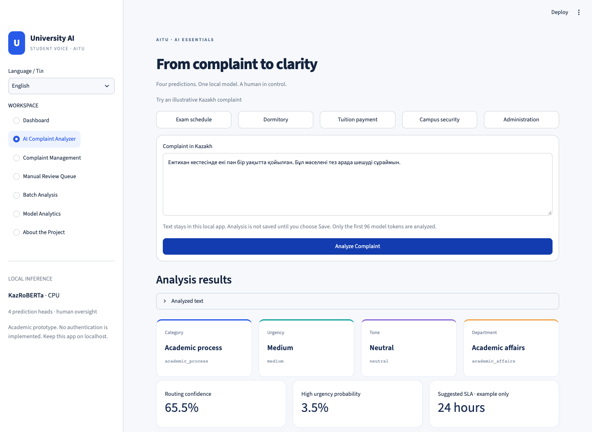
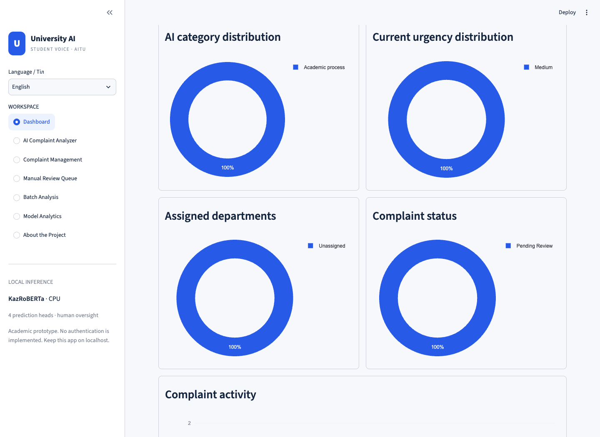

# AI University Complaint Management System

A standalone, local Streamlit application for the AI Essentials Master’s final project at Astana IT University. It runs the supplied **trained KazRoBERTa checkpoint** on CPU to analyze Kazakh complaints, proposes confidence-aware routing, and preserves human decisions in SQLite.

This is an academic demonstration, **not an official Astana IT University service**. It has no authentication and should remain bound to localhost. No model training, OpenAI API, fabricated predictions, or external complaint-text processing is used.

## Quick start in this prepared workspace

Python 3.11, the virtual environment, dependencies, and your supplied model are already installed locally.

```bash
cd /Users/altair/testPY/AI_Essentials
source .venv/bin/activate
streamlit run app.py
```

Open **http://localhost:8501**. The application database starts empty. Analyze a complaint, then explicitly choose **Save complaint** to register it.

## Installation on another machine

Use Python 3.11. The tested environment is Apple Silicon macOS with the CPU build of PyTorch; no CUDA, GPU, MPS, or Rosetta is required. The pinned PyTorch wheel requires macOS 14 or later. Allow several GB for the environment and model.

```bash
python -m venv .venv
source .venv/bin/activate
pip install -r requirements.txt
python scripts/setup_model.py /path/to/KazRoBERTa_Trained_Model.zip
python scripts/smoke_test.py
streamlit run app.py
```

If `python` resolves to a different version on your Mac, create the environment with `python3.11 -m venv .venv`. The application requirements contain six runtime dependencies, separate from the Colab research environment. Tested direct dependency versions are pinned; there are no CUDA-specific requirements.

### Model placement and offline operation

```text
model/
  model.pt                 # trained multi-task state dictionary, ~318 MiB
  config.json              # exported task order, label maps, routing settings
  tokenizer.json           # exported complete tokenizers graph
  tokenizer_config.json
  encoder_config.json      # base RoBERTa architecture, ~636 bytes
```

`setup_model.py` reads only the four expected files from the trusted ZIP, preventing arbitrary archive-path extraction. If needed, it downloads **only the small base encoder configuration** from [the original KazRoBERTa repository](https://huggingface.co/kz-transformers/kaz-roberta-conversational/blob/main/config.json). It does not download base model weights. The export’s `config.json` is an application configuration, so it must not be replaced with the encoder configuration.

For a fully offline setup, supply a previously obtained encoder config:

```bash
python scripts/setup_model.py /path/to/KazRoBERTa_Trained_Model.zip \
  --encoder-config /path/to/encoder_config.json
```

After setup, inference is fully local: no Hub requests are made during loading or prediction. `st.cache_resource` keeps one loaded model per server process, with a lock around inference. Restart Streamlit after replacing model files.

The trained weights have **not been assumed to exist in a public repository**. If you later publish the trained export in a Hugging Face repository with the four files at its root, use:

```bash
python scripts/setup_model.py --hub-repo YOUR_ACCOUNT/YOUR_TRAINED_EXPORT --revision COMMIT_SHA
```

Keep model weights outside Git. Use only a trusted checkpoint; the loader uses PyTorch `weights_only=True` and strict state-dictionary matching.

## Seven application sections

| Section | Functionality |
|---|---|
| Dashboard | Database-derived KPIs, category/urgency/department/status distributions, daily trends in Asia/Almaty, recent records, empty state |
| AI Complaint Analyzer | Five illustrative Kazakh examples, real CPU inference, four predictions, complete probability charts, routing reasons, example SLA, explicit save |
| Complaint Management | Literal text/ID search, category/current urgency/assigned department/status/review filters, date sorting, original AI details, human assignment, notes, resolution, audit history, CSV export |
| Manual Review Queue | Potentially urgent cases first, full complaint and AI snapshot, urgency/department correction, explicit approval, immutable original AI predictions |
| Batch Analysis | UTF-8 CSV upload, text-column selection, preview, batched inference with progress, invalid-row reporting, CSV export, explicit opt-in persistence |
| Model Analytics | Actual reported test results, grouped F1 chart, ranking, urgency misses, validation routing trade-off, original SVM confusion-matrix image |
| About the Project | Background, objectives, dataset/methodology, architecture, findings, limitations, responsible AI, future work |

English and Kazakh navigation, labels, and explanations are supported. Canonical prediction taxonomy and CSV field names remain stable so results can be matched to the research export. Some low-level dependency/validation error details are displayed in English.

## Screenshots

Screenshots are captured from the real application using illustrative test complaints and an isolated QA database; they are **not real university complaint records**. The normal application database is separate.





## Architecture and project structure

```text
Browser → Streamlit views → local tokenizer → KazRoBERTa → routing policy
                                      ↓ explicit save / human review
                                    SQLite + change history
```

```text
app.py                    # application shell, language, navigation
.streamlit/config.toml    # light theme, localhost binding, upload limit, telemetry off
src/
  config.py               # paths, taxonomy/config validation, limits
  model_loader.py         # exact shared encoder and four-head architecture
  inference.py            # single and batch prediction; no dummy fallback
  routing.py              # confidence, review reasons, priority, example SLA
  database.py             # versioned schema, transactions, audit, conflict detection
  analytics.py            # metrics, filters, daily aggregation
  translations.py         # bilingual interface and stable taxonomy labels
  ui.py, record_ui.py      # reusable charts, cards, record editor
  utils.py                # notebook normalization, CSV handling, time display
views/                    # seven functional page modules
model/                    # local ignored model artifacts
assets/                   # CSS, original research image, UI screenshots
data/research/            # transcribed notebook metrics and provenance
data/complaints.sqlite3   # local runtime database, created on first use; ignored
scripts/                  # model setup, actual inference smoke test, optional browser QA
tests/                    # policy, model, database, and Streamlit integration tests
```

There is no separate backend server or training process. Changing sections does not create new complaint records. The supplied 1,000-row research CSV is not automatically imported into operational storage.

### Exact model reconstruction

The model reproduces notebook cell 15:

- `encoder`: `AutoModel.from_config` using the verified RoBERTa base configuration: 6 layers, 768 hidden units, 12 attention heads, 52,000-token vocabulary.
- Attention-mask-weighted mean over token embeddings, denominator clamped at 1.
- One shared dropout layer with probability **0.2**.
- `heads`: `nn.ModuleList` of four independent linear classifiers, in **category → urgency → tone → department** order.
- The full trained state dictionary is loaded with **strict=True**; all 83,462,415 parameters come from the checkpoint before inference.
- CPU, `model.eval()`, and `torch.inference_mode()`; no stochastic predictions.
- Unicode NFC, removal of U+200B–U+200D and U+FEFF, whitespace cleanup; original characters, case, punctuation, and original complaint text are retained.
- Exported tokenizer graph, dynamic padding, truncation at **96 tokens**. Truncation is disclosed in the UI; complete original text is stored after saving.

The class order comes directly from the export:

| Target | Labels in index order |
|---|---|
| Category | academic_process, administrative_services, campus_environment |
| Urgency | high, low, medium |
| Tone | dissatisfied, intense_negative, neutral |
| Department | academic_affairs, facilities_office, faculty_dean_office, finance_office, security_ombudsperson, student_service_center |

### Routing and priority

```python
confidence = min(max(p_category), max(p_urgency), max(p_department))
requires_review = confidence < 0.75 or p_high >= 0.30
```

Tone confidence is intentionally excluded. Boundary values are tested. The final exported threshold of **0.75** takes precedence over the earlier notebook inference cell’s 0.60. Routing uses full-precision probabilities, not rounded display values.

Operational review priority is elevated when P(high) ≥ 0.30, even if predicted urgency is medium. The original predicted urgency is preserved. The example SLA remains tied to predicted urgency: high 4 hours, medium 24, low 72. These are **research examples, not university policy**. Potentially urgent cases need prompt human assessment regardless of an example SLA.

“Auto-Routed” means a local assignment to the suggested department when explicitly saved. No department receives an external notification. Flagged complaints remain unassigned until human review. The UI requires review approval before advancing an outstanding flagged case to Assigned, In Progress, Resolved, or Closed.

### Persistence and audit behavior

SQLite uses WAL, foreign keys, transactions, and `PRAGMA user_version` migrations. Unique save tokens make repeated save clicks idempotent; batch inserts are atomic. Status, assignment, operational urgency, and administrator notes are editable. Original predictions, full probability distributions, thresholds, and routing reasons remain in an immutable application snapshot.

Every update records previous/new status, department, urgency, previous notes, new notes, action, and UTC timestamp. A version counter detects stale edits. Resolved/Closed set resolution time; reopening clears it. The original review flag remains preserved after approval, while `reviewed_at` indicates completion.

Statuses: New, Pending Review, Assigned, In Progress, Resolved, Closed. Timestamps are stored in UTC and displayed in Asia/Almaty. Database-derived high-priority counts include active high-urgency human decisions or P(high) ≥ 0.30; average confidence includes all saved complaints.

For a separate database or model directory:

```bash
COMPLAINT_DB_PATH=/absolute/path/demo.sqlite3 \
COMPLAINT_MODEL_DIR=/absolute/path/model \
streamlit run app.py
```

The database file is restricted to its owner where supported. It is **not encrypted**. Back up SQLite using its backup API, or stop the app before copying it; copying only the main file during WAL activity is unsafe. For a full local reset, stop the app and remove the database and any corresponding `-wal` / `-shm` files. The maintenance-only `Database.delete` method removes a complaint and its audit rows; no destructive delete button is exposed in the UI.

## Research results

These are **reported held-out test Macro-F1 values from 150 complaints**, verified against saved notebook outputs. They are separate from dashboard analytics.

| Model | Category | Urgency | Tone | Department | Mean |
|---|---:|---:|---:|---:|---:|
| Linear SVM | .9867 | .9722 | 1.0000 | .9334 | **.9731** |
| BiLSTM + Attention | .9733 | **.9790** | 1.0000 | .8642 | .9541 |
| XLM-RoBERTa | .9798 | .9313 | .9681 | .9000 | .9448 |
| KazRoBERTa | **.9933** | .9510 | .9844 | .9128 | .9604 |

SVM achieved the highest mean F1; KazRoBERTa is deployed to demonstrate shared-encoder multi-task Transformer inference. Among 38 high-urgency test complaints, SVM/BiLSTM missed 3 each; KazRoBERTa/XLM-RoBERTa missed 5 each.

Validation routing coverage / department accuracy among auto-routed cases: 0.30 → 73.33% / 88.18%; 0.60 → 56.67% / 94.12%; 0.75 → 48.00% / 97.22%; 0.85 → 28.67% / 100%. All include the additional high-urgency review rule. At 0.75, one high-urgency validation case was still incorrectly auto-routed. The small 0.85 subset’s observed 100% accuracy is not a safety guarantee.

The original SVM test confusion-matrix image was extracted from the notebook. Other models’ numerical matrices are unavailable and are not fabricated. See [artifact provenance](data/research/PROVENANCE.md).

## Testing

```bash
pip install -r requirements-dev.txt
python -m pytest -q
python scripts/smoke_test.py
```

The suite covers normalization, blank/invalid input, strict real checkpoint loading, four output shapes, label mappings, real single/batch probability consistency, masked padding, truncation, routing boundaries, CSV validation, database CRUD and audit, transaction rollback, duplicate saves, review approval, stale-edit protection, all seven sections in both languages, and analyzer/batch UI save workflows.

Model-dependent tests use the real checkpoint, never a substitute model. If artifacts are absent, these tests are explicitly skipped; a skipped model test is not proof of working inference. Test databases are temporary and never populate your application database. Streamlit UI tests use [the official AppTest API](https://docs.streamlit.io/develop/api-reference/app-testing/st.testing.v1.apptest).

Optional visual QA, using installed Google Chrome on macOS:

```bash
pip install playwright
COMPLAINT_DB_PATH=/tmp/university-complaints-visual-qa.sqlite3 streamlit run app.py
# In another terminal, with the virtual environment active:
python scripts/browser_check.py
```

Use a fresh disposable database: this script saves an illustrative complaint. It captures desktop/mobile screenshots, navigates the seven sections, and checks browser exceptions and horizontal overflow. It does not require downloading another browser.

## Responsible AI and privacy

- The dataset has 1,000 Kazakh complaints split 700/150/150 with seed 42, stratified by category × urgency. Similar textual patterns across the non-group-aware split may inflate generalization estimates.
- Softmax values are uncalibrated, not guaranteed correctness. The 150-case test set and limited training runs cannot establish real-world safety or fine-grained model superiority.
- Human review is required for uncertain or potentially urgent routing. This is not a monitored emergency channel and cannot autonomously resolve critical safety incidents.
- Use anonymized demonstration texts. No external analytics tracking or complaint-content logging is implemented. Streamlit usage statistics are disabled.
- Uploads stay in server memory, are capped at 5 MB / 1,000 rows, and are parsed as UTF-8 CSV. Individual texts are capped at 10,000 characters. Numeric, empty, and missing text values are rejected as row errors.
- CSV exports neutralize leading spreadsheet formula characters; source text in the database is unchanged. Exports can still contain sensitive information and need careful handling.
- No authentication, encryption, institution-approved policy, retention automation, or real department integrations are implied. These must be designed before any institutional deployment.

## Troubleshooting

| Symptom | Action |
|---|---|
| Missing `model.pt` / tokenizer / encoder config | Run `scripts/setup_model.py` with your trusted export. |
| Cannot obtain base configuration | Use `--encoder-config` with a previously downloaded file; do not substitute the app config. |
| Checkpoint key/shape mismatch | Verify the original trained multi-task export and base config. The loader intentionally fails instead of generating dummy results. |
| Wrong Python / no compatible PyTorch wheel | Use native Apple Silicon Python 3.11 on macOS 14+. Older OS versions require a separately validated compatible PyTorch environment. |
| First prediction is slow | The CPU model is loaded once per process. Later predictions reuse the cached resource. |
| Memory pressure during CSV inference | Choose batch size 4 or 8. |
| Text was truncated | Only the first 96 tokens reach the model. Review the full text manually. |
| Cannot advance a flagged record | Approve it in Manual Review Queue, including a selected assigned department. |
| Stale-record conflict | Reload the record before reapplying edits; someone or another tab changed it. |
| Port 8501 is occupied | Stop the existing server, or use `streamlit run app.py --server.port 8502`. |
| No dashboard charts | Save at least one analyzed complaint; charts are never seeded with invented data. |

## Verified delivery

The final local run passed **32 tests**, the actual CPU model smoke test, and a Chrome navigation/rendering check. Desktop/mobile screenshots are included. See [VALIDATION.md](VALIDATION.md) for the verification scope and remaining limitations, and [model checksums](data/research/model_checksums.json) for the artifacts used.
